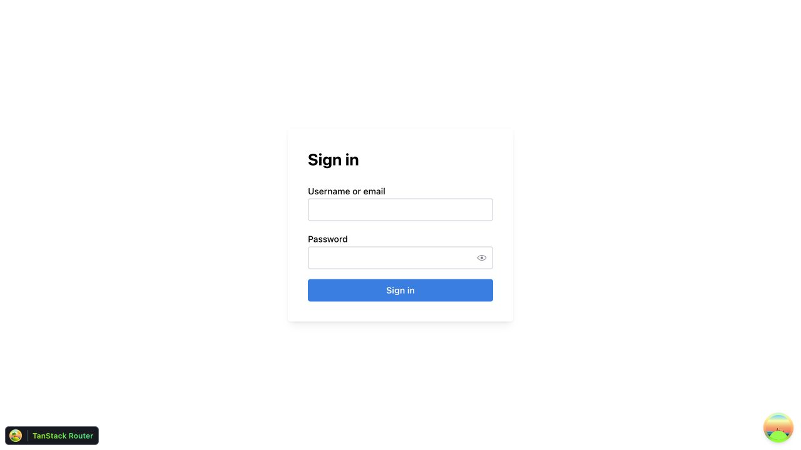
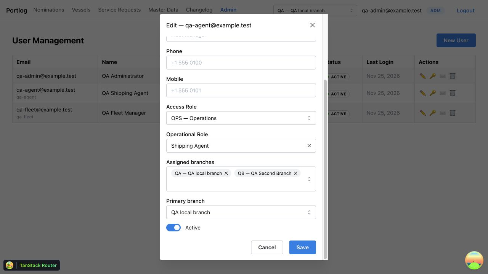
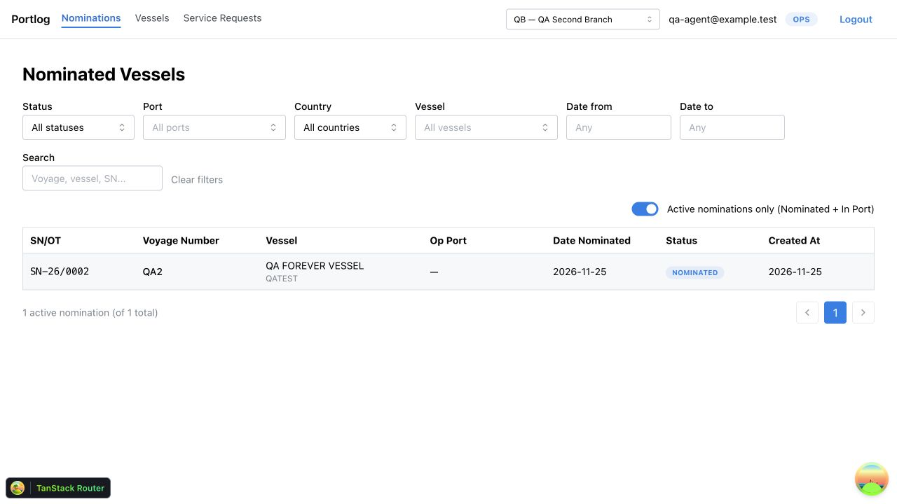
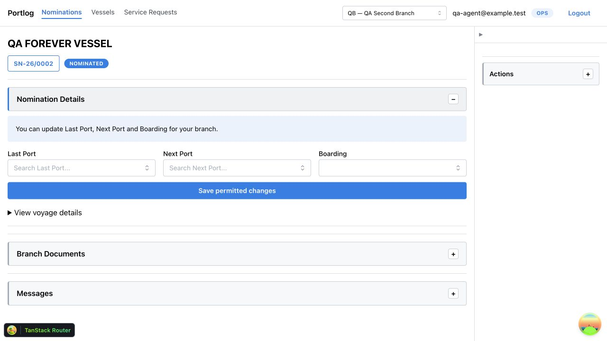
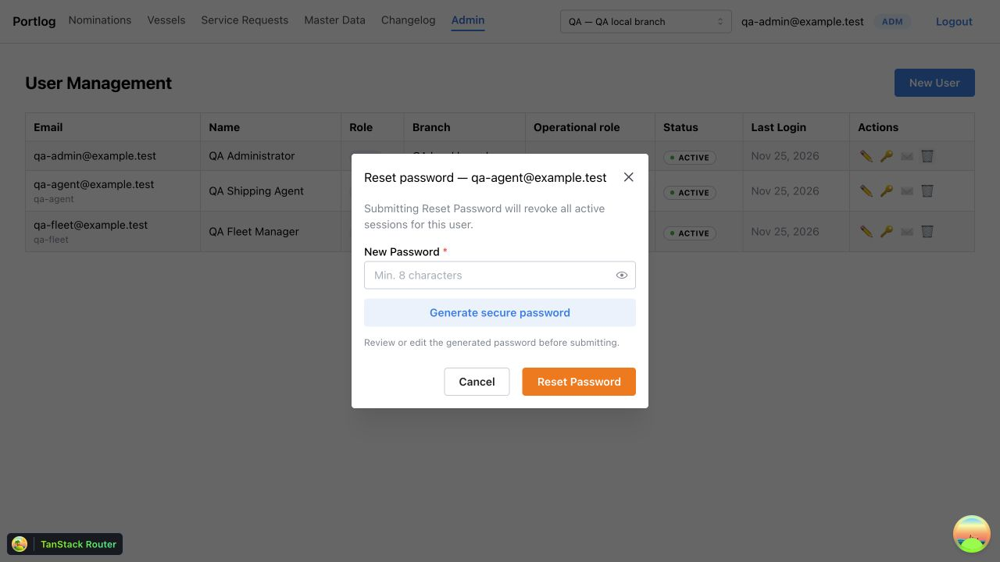
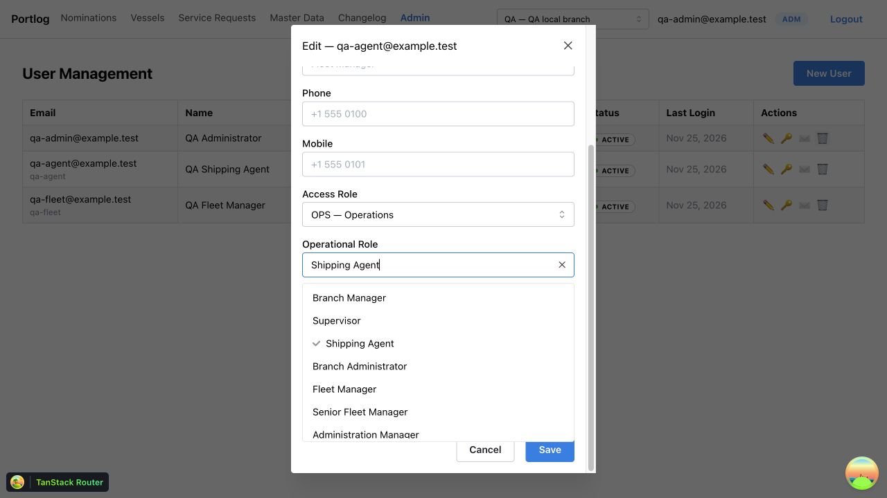
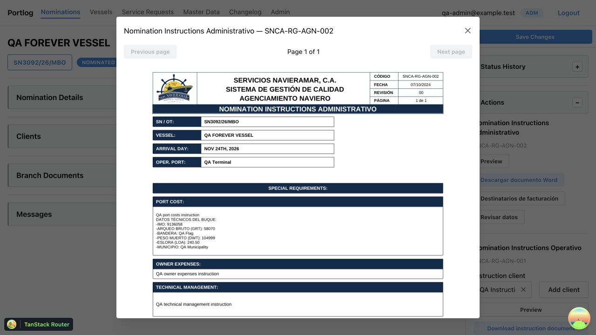
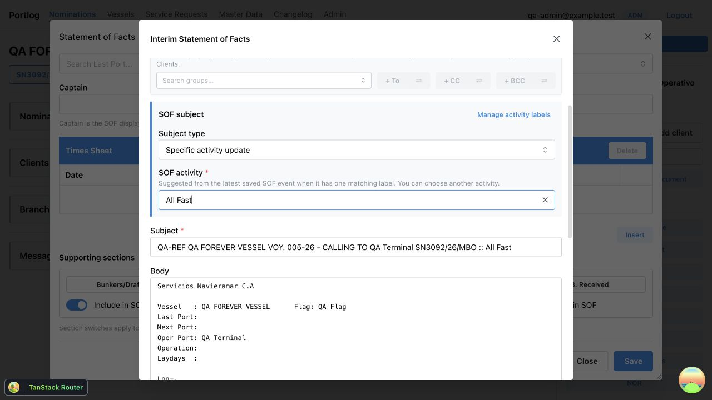
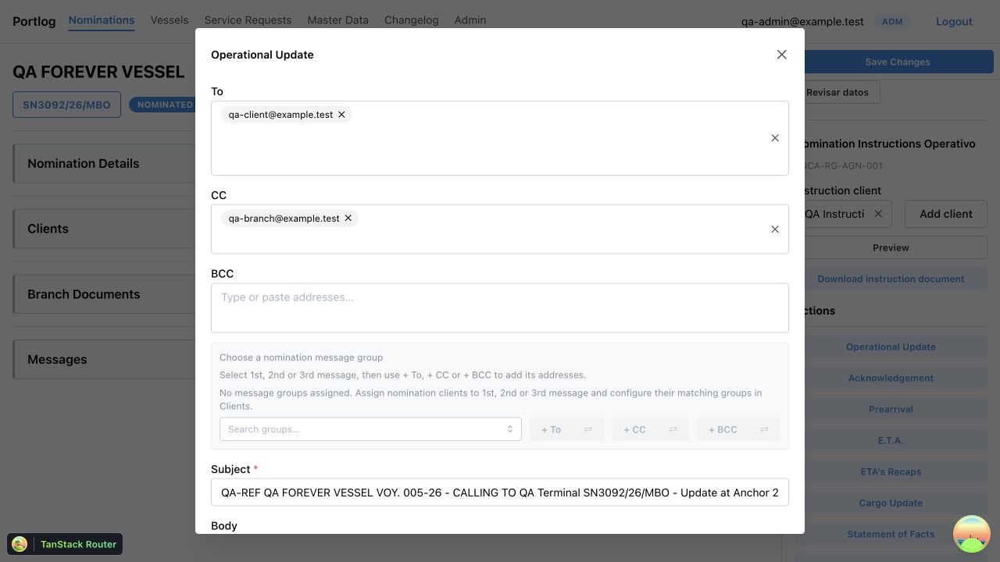
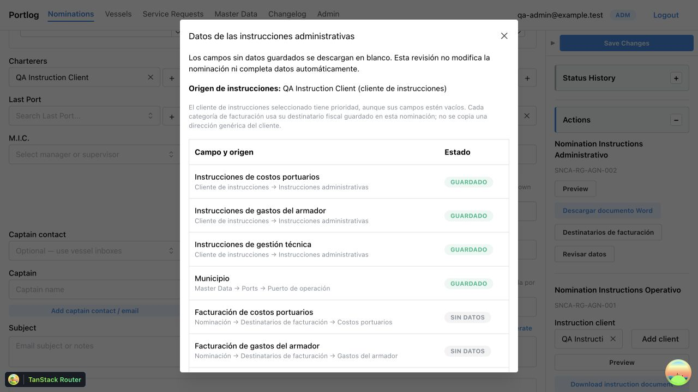

# In-app changelog

The authenticated `/changelog` route is available to ADM and the explicit Fleet Manager access role (FLT) from **Changelog** in the shared navigation. Shipping agents (OPS) cannot open the route. It inherits the existing login/refresh behavior and uses Mantine components.

Entries live in `frontend/src/features/changelog/data.ts` as typed static data. No API, database table or migration is needed for the changelog. Add entries newest first with unique IDs, Spanish copy, a date-only editorial date and the America/Montevideo reference. Status labels must distinguish local verification, partial verification, approved deferral and actual production deployment.

The 15 October 2026 entry covers nomination and port improvements, message assignments, ETA Recaps, attachments, resend and retry handling, safer send preparation and receipt printing. Its requirement-review summary is 10 verified locally, 1 partial and 2 approved deferrals. Pre-Arrival materials and Reply to Client await approved materials. The release was deployed on 19 October 2026. Restored copies and production comparisons verified preservation of original data, relationships and all existing object versions. The entry marks deployment and preservation verified while retaining the original local 10/1/2 disposition as historical evidence. This does not certify every workflow, external mail delivery or physical printing.

Keep entries useful to operators. Do not include credentials, internal audit findings, infrastructure details, operational records or personal data. Exact replay can be blocked when original document files or their provenance are missing; existing message-group assignments require operator review.

Run `npm run test -w @portlog/frontend`, `npm run typecheck` and `npm run build`. The route tree is generated by the router plugin; never edit it manually. Verify login redirection, ADM/FLT access and OPS denial, reload, calendar date stability and screenshot readability using synthetic isolated data.

## Entry for 27 October 2026

Focused release of the small, aligned, low-preservation-risk feedback items. Includes vessel flag lookup and honest prefill feedback, manager-priority defaults, reference-aware generated subjects with manual-edit preservation, narrow Owner/Operator instruction-field fallbacks, clearer nomination-only group selection and retry/empty-group safeguards, and client-creation guidance. The existing branch operating-port filter was verified rather than reimplemented.

Local verification: 167 targeted backend tests and 99 frontend tests; all-workspace typechecks, full build, source lint, and isolated browser checks with synthetic fixture services. The changelog adds its own editorial-contract regression check. No operational data migration is required. Browser checks do not certify external email delivery, directory completeness or full production workflow acceptance. Earlier approved deferrals and the October 15/19 release history remain unchanged.

## Follow-up release for 27 October 2026

Adds explicit HH:mm input to all four ETA timestamps, guards against implicit nomination submission from numeric fields, and gives optional client contact/group queries visible loading, failure and retry handling without clearing entered values. Two feedback items are fixed (004/017); 018 remains partially verified because its original stuck-window symptom was not reproduced, and 020 remains partial because cross-field To/CC repetition is an existing recipient policy. No recipient rules or data migrations are changed.

Verification: frontend and backend typechecks, frontend production build, changed-source lint, 113 frontend tests before the additional changelog contract, 137 focused backend tests, and isolated browser checks. All four ETA fields were checked in en-US/Caracas and es-VE/Montevideo. No real email was sent. Production deployment and data-preservation results are recorded separately in the deployment evidence. Earlier release notes and approved deferrals remain unchanged.

## SOF and routing release — 27 October 2026

Seven feedback items (002, 009, 020, 026, 027, 030, 031): canonical saved SOF sections in preview/email/PDF, interim dispatch classification, section switches, parcel figures, complete letters/remarks, retry preservation, Charterers instruction defaults, terminal recipient normalization and Datalastic measurement validation/persistence. Additive migration 20261027183000_interim_sof_dispatch adds SOF_INTERIM only. All 820 tests passed before the changelog entry; full build, typechecks, lint, browser checks and PDF visual review passed. The enum migration was rehearsed on an isolated restored copy with all 1,700 rows unchanged. No historical PDFs or operational records are bulk rewritten.

## Captain and routing defaults release — 27 October 2026

Feedback 014/010/021/023: optional captain Contact link with vessel-inbox fallback, nomination-owned group overrides over live shared defaults, explicit always-copy/branch CC enforcement on new sends, and single-send Reply to Master choices. Existing stored assignments are not backfilled. Archived replays retain their original envelope. Additive migration 20261027230000_nomination_routing_defaults adds five nullable FKs/indexes with deletion protection. The prior 836-test suite, full build/typechecks/lint, fixture-browser checks and isolated preserved-data migration rehearsal passed. Production release evidence is recorded separately.

## Clarified video requirements — 28 October 2026

Addresses PL-FB-003, 014, 016, 022, 024, 025 and 029. PL-FB-019’s existing confirmed-message print/Save as PDF workflow was exercised, including a five-page archive; clearer guidance is added. No automatic PDF retention policy, system folder writes, historical agency conversion or role restrictions were invented. Full Agency remains valid for existing/API records, but is absent from new UI choices; new default is Charterer’s Agents.

Pre-arrival To now resolves the captain contact/vessel inboxes; explicit CC, always-copy and branch copying remain. Terminal message signature removes only OPERATIONS. Parcel labels identify terminal-offered and vessel-requested figures. Activity aliases query existing entries; 15-second search timeout and visible retry preserve saved values.

Terminal materials use two nullable EmailAttachment columns (terminalPortId, terminalRetiredAt), a restricted Port FK and index. Active files are selected by the nomination’s exact operating terminal. Retiring preserves source bytes; staged cleanup excludes active and retired library records. Filing only accepts the uploader’s unowned unsent files, using a conditional update. Each send uses the existing independent attachment archive. Existing files are not reassigned.

Recap discovers confirmed sent ETA/NOR records on this nomination across both dispatch routes. Operators select archived attachments or create an attachment PDF from the stored original PDF/body, with recorded metadata. Failed/pending sends and unrelated message types are excluded. Missing stored body/PDF is explicit. Archived HTML rendering disables scripts and remote/file resources. PDF staging does not send a message.

Remaining inputs: approved terminal files, agent directory, branch-address confirmation, administrative instruction template/Special Requirements. Add-client symptom remains unconfirmed. Deployment authorized on 28 October; release requires a restored fresh backup, off-server copy, additive migration, and live record/storage preservation verification.

## Operational follow-ups — 28 October 2026

Implements the new branch-side port maintenance, strict scoped operating-port choices, ordered port filters, nomination-side captain email maintenance, reliable default/manual parcel units, per-account/browser pending nomination, ETA auto-checkboxes, 24-hour cargo ETC, SOF layout/footer and key-meeting free-text comments.

The branch editor operates on the existing Port.branchId relation, not a second list. Conditional assignment guards against overwriting concurrent changes; detach retains the port. Changing branch in a nomination clears port/pier explicitly; schema accepts null so this can be persisted on edit. Saved mismatches are not rewritten in bulk. Captain email editing explicitly updates a shared Contact; creating a contact links it only after the nomination is saved. Captain-To defaults are retained from 613c492.

Product lookup now handles late exact-name results. Manual unit choices are protected from delayed defaults; selecting the same unit no longer deselects it. Draft storage is keyed by account and version, preserves incomplete fields and date values, offers explicit resume/discard, survives navigation/reload, and clears after confirmed creation. It is one pending new nomination per account/browser, not a server-side draft or cross-device sync. Storage errors are visible; normal Create validation still applies.

Parcel comments are additive JSON data (no database migration), retained with existing figures and included in canonical new email/PDF SOF content under the existing parcel switch. No numeric interpretation of percentages. ETA date interaction selects the checkbox but does not undo a later explicit manual uncheck at save. Cargo ETC uses the explicit 24-hour input, blocking save/send on invalid time.

SOF UI subagent verified desktop/mobile layout and save-before-compose. Branch signature content remains TO BE RECEIVED; no guessed signatures or role changes. Deployment authorized for this branch; fresh restored backup and live data/storage preservation verification required.

## November 24–25, 2026 — requirements implementation

Two new entries cover both implementation rounds since the last published notes. Both have **deployment pending**; local verification does not imply release to production. November 24 records twelve locally complete portions and four partial deliveries. November 25 records eight newly complete requirements and five advanced but incomplete requirements. The overall Beads board remains the source of current ticket status: 20 complete, 11 open.

November 24 covers vessel-first headings and initially collapsed sections; explicit vessel VOY/TBC; admin-only cancellation; both administrative/operational NI previews alongside Word downloads; concise document actions; interim SOF wording, simpler compose UI and sixteen controlled activity labels; explicit Anchor/Alongside/Cargo update modes; subject-only ten-minute rounding and manual-value preservation; NI source diagnostics; subject and authenticated-signature preparation; branch reconciliation boundaries.

November 25 covers backward-compatible username/email login, multiple assigned branches and one primary, top-bar context switching and refresh/cache behavior, cryptographic password generation before explicit reset, current persisted access roles, national Fleet Manager capabilities, branch-wide agent visibility and three-field editing, management-only Clients/history, service-request/document/attachment branch isolation and staged-upload ownership. Seven descriptive operational positions remain separate from access roles.

The business-reference format and independent continuous allocator are implemented but **inactive until a verified handover** supplies the legacy export/hash, final counters, cutover time, OT scope and reconciled branches. Historical references, sent messages and documents remain preserved. Actual account/mailbox/position assignments, signature policy, outgoing mail delivery, FOREVER identity/date/source client and 2FA policy remain unresolved; no data or approval was invented.

### Screenshot gallery

`frontend/src/features/changelog/data.ts` supports optional section `screenshots` with local public URLs, descriptive alt text and captions. The page renders a responsive gallery; each image links to the original for full-size inspection. Screenshots contain **synthetic QA data only**, with no production records or credentials. They are public build assets, so never place private operational captures in this directory. The captions identify test data and do not claim production acceptance.

| Feature                                             | Capture                                                                                               |
| --------------------------------------------------- | ----------------------------------------------------------------------------------------------------- |
| Individual username/email login                     |                                      |
| Multiple branches and one primary                   |                     |
| Branch switching                                    |                               |
| Restricted agent editing                            |                       |
| Password generator control                          |  |
| Operational positions, independent from access role |                           |
| Administrative NI preview                           |                                     |
| SOF activity subject                                |                          |
| Anchor subject rounding                             |                    |
| NI source diagnostics                               |                  |

The new entries have their own verification-summary labels and explanations. Historical entries retain their original wording and verification/deployment evidence. Technical evidence lives in the local requirements delivery records; product notes describe operator-visible behavior.
